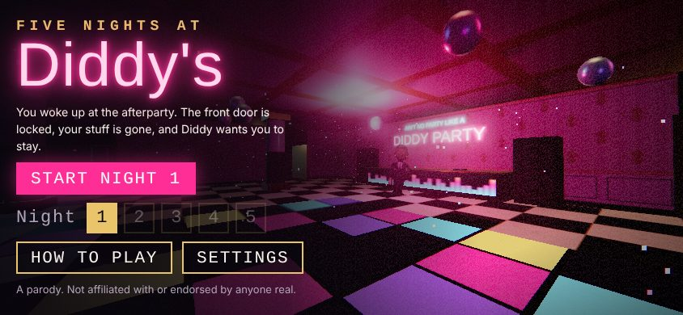

<!-- PROTOTYPE - NOT FOR PRODUCTION -->
<!-- Question: Is a first-person "escape the party" chase against a meme villain fun across five short nights on a phone? -->
<!-- Date: 2026-10-22 -->

# Five Nights at Diddy's

A mobile-first parody horror game. You wake up at the afterparty in Diddy's mansion. The
front door is locked and your stuff is scattered around the house. Find it and get out, or
survive until 6 AM. Diddy hunts you the whole time. If he catches you, you get diddled.

## Hypothesis

A short, readable chase loop (scavenge, hear him coming, break line of sight, drop baby
oil, run for the door) is fun for five escalating nights on a phone. Two exits keep it from
becoming a pure hiding game: escape early, or outlast the clock.

## How to run

Open `prototype.html` in a phone browser, turned sideways for the best view. Portrait works
too. Desktop browsers work as well. It's one self-contained file, with no build step and no
server. It needs an internet connection the first time, because Three.js (r160, jsDelivr)
and the fonts (Google Fonts) load from CDNs.

| Action | Phone | Keyboard / mouse |
|---|---|---|
| Move | Left thumb (joystick) | WASD |
| Look | Drag with right thumb | Mouse |
| Sprint | RUN (toggle) | Shift |
| Flashlight | LIGHT | F |
| Drop baby oil | OIL (shows how many you have) | Space |
| CCTV map | CAM, tap the map to close | C |
| Pause | II | Esc |

## What's in it

- **The mansion:** 11 rooms plus hallways on a 33 × 24 grid of 3 m cells (`MAP` in the
  script): guest bedroom, library, master suite, kitchen, baby oil storage, ballroom, indoor
  pool, VIP lounge, home theater, grand foyer and wine cellar. Every texture is drawn
  procedurally on canvas, so the game ships no image files.
- **Diddy:** a hand-drawn caricature shown as a camera-facing billboard. He's drawn from
  reference photos the requester supplied: close-cropped hair with a sharp lineup, pencil
  mustache and goatee, diamond studs, black suit with white shirt and black tie, a rose-gold
  watch and a two-finger sign. He also holds a bottle of baby oil. When he's chasing he puts
  on small rose-tinted glasses, his eyes glow red and he grins. The reference photos
  themselves are not in this repo.
- **His behavior:** a state machine (dance → patrol → search → alert → chase → stunned) with
  A\* pathfinding on a 1 m nav grid. He sees you (vision cone, walls block sight, the
  flashlight extends his range) and hears you sprint.
- **His lines:** "Let me take you out shopping, playa!" and "You deserve it, daddy!" while
  chasing. "Ain't no party like a Diddy party!" when he catches you. They're spoken with the
  browser's speech engine and also shown as subtitles.
- **Systems:** stamina, a battery shared by the flashlight and the CCTV map, baby oil
  puddles that make him slip, and a final-item trigger that sends him straight at you.
- **Atmosphere:** party music synthesized with WebAudio (it gets muffled the further you are
  from the ballroom), positional footsteps, a heartbeat, bloom, film grain and red
  danger edges.
- **Custom face:** Settings → "Use a photo" swaps the drawn face for any picture on your
  phone. The photo stays on the device.

## Built for phones

- **Controls:** a thumb-arc button cluster on the right, a floating joystick on the left
  that rests visibly at bottom-left, and vibration on pickups, slips, being spotted and
  being caught (Android).
- **Screen:** the field of view widens in portrait so the view isn't cramped. Where the
  browser allows it, the game goes fullscreen, locks to landscape and keeps the screen
  awake.
- **Graphics presets:** High (bloom + shadows), Medium (bloom) and Low. Medium is the
  default on phones. If a night runs below about 24 fps, the game steps down one preset and
  says so.
- **Draw calls:** static props are merged into one mesh per material, which cuts a frame
  from 291 draw calls to 94.

All tuning lives in `TUNING` and `NIGHTS` at the top of the script. Each night is faster,
sharper-eyed, darker and longer than the last, and asks for more items.

## Status

In progress. Built and machine-tested; it has not been playtested by a person on a real
phone yet.

## Verification so far

These ran headless in Chromium (SwiftShader) with no console errors:

- Every room, the player spawn and the exit are reachable on Diddy's nav grid.
- 90 s on night 3: he leaves the party after the grace period, patrols without getting
  stuck, and can hunt down a hiding player.
- A visible player is spotted and caught in about 4 s (alert, then chase, then jumpscare).
- Baby oil makes him slip and stay down for the night's stun time, then he resumes the hunt.
- Surviving to 6 AM and escaping with every item both win the night and unlock the next one.
- Simulated touch on a phone (844 × 390 landscape and 390 × 844 portrait):
  - the joystick moves the player and a right-thumb drag turns the view;
  - OIL drops a puddle;
  - CAM opens the map and a tap closes it;
  - pause works.
- Screenshots in `screenshots/` cover both phone orientations and desktop.

## Findings

Pending a real playtest. Things to watch:

- Is night 1 forgiving enough? (Diddy chases at 4.4 m/s; you walk at 3.7 and sprint at 6.4.)
- Is the RUN toggle comfortable while steering with both thumbs?
- Does the CCTV map make hiding too easy, or is the battery cost enough?
- Frame rate on a mid-range Android phone on the Medium preset.

## Known limits

- Software rendering (no GPU) runs at 1–3 fps. Real GPUs are fine.
- Voices depend on the browser's installed speech voices. Subtitles always show.
- iOS Safari doesn't allow fullscreen or orientation lock for web pages, so on iPhone, turn
  the phone sideways yourself.
