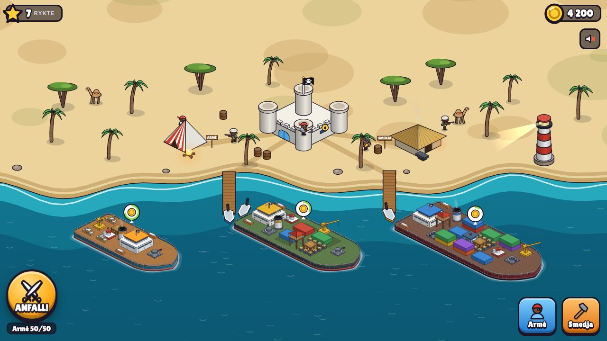
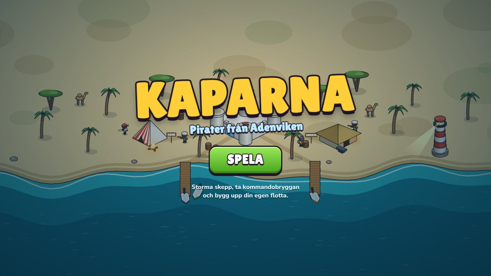
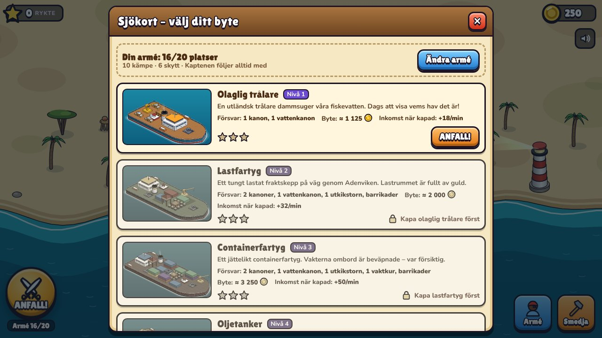
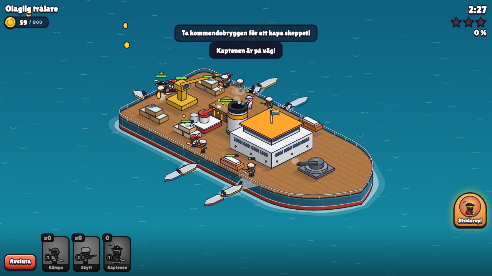
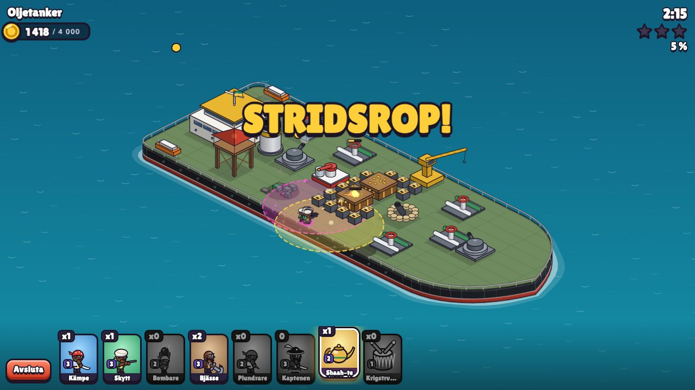
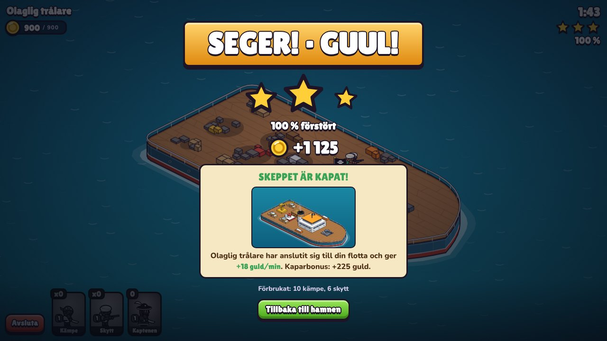
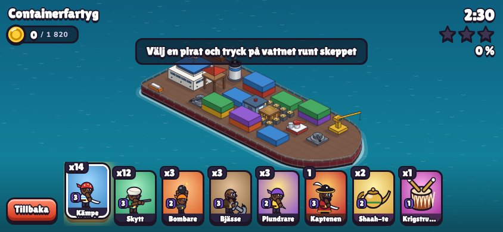

<!-- PROTOTYPE - NOT FOR PRODUCTION -->
<!-- Question: Är det roligt att kapa skepp med Clash-liknande anfall? -->
<!-- Date: 2026-10-22 -->

# Kaparna – pirater från Adenviken

Ett somaliskt piratspel i Clash of Clans-stil, spelbart i webbläsaren. Du är kapten för en
piratbesättning på Somaliakusten. Välj ett skepp på sjökortet, skicka ut dina pirater i
skiffar runt skrovet och se dem entra däcket, slåss mot vakter och kanoner och plundra
lasten. Tar ni kommandobryggan är skeppet kapat: piratflaggan hissas och skeppet seglar hem
till din hamn, där det tjänar guld åt dig. Guldet går till nya pirater och uppgraderingar,
och då klarar du nästa, svårare skepp.

## Hypotes

> Om spelaren sätter ut pirater runt ett skepp och ser dem storma däcket på egen hand
> (Clash-stil), så känns kapningen rolig och spelaren vill genast kapa nästa skepp.
> Vi vet att det stämmer om testspelare frivilligt startar en andra och tredje strid
> inom 10 minuter.

**Riskablaste antagandet:** att utplacering från vattnet (skiff → entring) känns lika
direkt som Clash egna utplacering på land. Därför byggdes striden först och mest.

## Så kör du

- **Enklast:** öppna `kaparna.html` i valfri webbläsare (dubbelklicka). Allt ligger i en fil.
- **Utvecklingsläge:** öppna `index.html` (läser `css/` och `js/` direkt).
- Bygg om enfilsversionen efter ändringar: `python3 build.py`
- Liggande läge rekommenderas på mobil. Nyp eller scrolla för att zooma, dra för att panorera.
- Spelet sparas i webbläsarens lokala lagring. Nollställ med `KAPARNA.reset()` i konsolen.

## Så spelar du

1. **ANFALL!** öppnar sjökortet. Välj ett skepp (det första är en olaglig trålare).
2. Välj en trupp i kortraden längst ner och **tryck på vattnet runt skeppet**. En skiff
   kör fram och piraten entrar med änterhake. **Håll inne** för att skicka flera.
3. Trupperna väljer själva mål: närmaste byggnad (Kämpe, Skytt), försvar (Bjässe),
   barrikader (Bombare) eller byte (Plundrare).
4. Stjärnor: ⭐ 50 % förstört · ⭐ kommandobryggan tagen (= skeppet kapat) · ⭐ 100 %.
5. **Kaptenen** är gratis i varje strid. När han är ombord kan du trycka *Stridsrop!*: han
   kallar på fyra kämpar, läker sig och blir rasande.
6. **Drycker:** *Shaah-te* (kryddat somaliskt te) läker, *Krigstrumma* ger raseri.
7. Hemma i hamnen: tryck på guldbubblan över dina kapade skepp för att samla in guld.
   **Armé** rekryterar trupper, **Smedja** uppgraderar trupper och Piratfästet
   (fler armé- och dryckesplatser).

| Skepp | Nivå | Försvar | Låser upp |
|---|---|---|---|
| Olaglig trålare | 1 | kanon, vattenkanon | Bombare, Shaah-te |
| Lastfartyg | 2 | 2 kanoner, vattenkanon, utkikstorn, barrikader | Bjässe |
| Containerfartyg | 3 | 2 kanoner, vattenkanon, utkikstorn, vaktkur, barrikader | Plundrare, Krigstrumma |
| Oljetanker | 4 | 2 kanoner, vattenkanon, utkikstorn, mörsare, vaktkur, barrikader | – |
| Lyxjakt | 5 | 2 kanoner, vattenkanon, 2 utkikstorn, mörsare, 2 vaktkurer, barrikader | – |
| Krigsskepp | 6 | 3 kanoner, vattenkanon, 2 utkikstorn, 2 mörsare, 2 vaktkurer, många barrikader | – |

## Status

**Pågår – byggd, inte speltestad av människor.** Prototyp-domslut: **NOT ASSESSED**
(byggd men inte spelad). Nästa steg: låt 3–5 personer spela utan instruktioner och
mät om de startar strid nummer två och tre på egen hand.

## Fynd hittills (automatiska)

- **Balans (huvudlös simulering, 12 strider per rad, enkel AI som sprider trupperna på två sidor):**
  med den armé en spelare rimligen har vid varje skepp blir det i snitt ~2 stjärnor.
  Med föregående skepps armé blir det 0–1 stjärna, så kurvan stiger som tänkt.
  Trålaren är medvetet lätt (2,5 stjärnor med startarmén) som introduktion. Kör själv i konsolen:
  `KAPARNA.simulate('oljetanker', {bjasse:3, kampe:14, skytt:12, bombare:3, plundrare:3}, {spells:{lakning:2, raseri:1}, levels:{kampe:3, skytt:3}})`
- Lastfartyget var för lätt i första versionen (3 stjärnor med startarmén); en extra kanon
  rättade det. Tankern var svårare än lyxjakten; en vattenkanon mindre rättade ordningen.
- **Prestanda:** statiska delar (skrov, däck, ruiner, terräng, containrar, barrikader)
  förrenderas och återanvänds. Om bildfrekvensen ändå sjunker under ~35 fps sänks
  upplösningen automatiskt.

## Skärmdumpar

| | |
|---|---|
|  |  |
|  |  |
|  |  |

## Filer

| Fil | Innehåll |
|---|---|
| `js/data.js` | All balans: trupper, försvar, skepp och layouter, ekonomi |
| `js/ship.js` | Skrovform, däcksrutnät, placering av byggnader och barrikader |
| `js/gfx.js` | Isometrisk projektion, kamera, ritprimitiver, förrenderade lager |
| `js/art.js` | Figurer (pirater, vakter), skiffar, flaggor, effekter, porträtt |
| `js/art-ship.js` | Skrov, däck, alla byggnader, ruiner, dryckszoner |
| `js/battle.js` | Stridssimulering (vägfinning, AI, projektiler, stjärnor, byte) + ritning |
| `js/harbor.js` | Hemmahamnen med fäste, läger, smedja, kameler och flottan |
| `js/ui.js`, `js/main.js` | Gränssnitt, sparning, inmatning, spelloop |
| `js/audio.js` | Syntetiserade ljud och pentatonisk trumslinga (inga ljudfiler) |
| `build.py` | Bakar ihop allt till `kaparna.html` |

All grafik ritas med kod (canvas), så det finns inga bildfiler. Allt innehåll är fiktivt:
skeppen, rederierna och flaggorna finns inte på riktigt.
